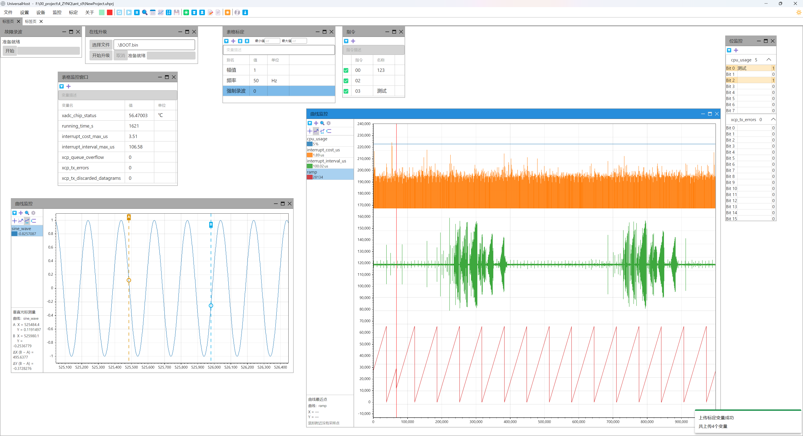

# UniversalHost

基于 XCP 协议和自定义 IAP 协议的通用上位机工具。

> 项目目前处于早期开发阶段，功能和接口可能会发生变化。

## 项目简介

UniversalHost 是面向嵌入式设备开发与调试的通用桌面上位机，集成实时数据监控、参数标定、故障录波上传和在线固件升级。通过 XCP 协议与 ELF/TI COFF 固件符号信息访问设备变量，通过自定义 IAP 协议完成固件升级，适用于日常调试、性能验证和设备维护。

## 特性

- **灵活的通信方式**：支持 UDP 和串口传输。全双工串口支持 XCP 数据监控、参数标定及 IAP 在线升级；半双工串口支持 IAP 在线升级。
- **高吞吐采集与大容量曲线显示**：实测以 10 kHz 采样率采集每次 256 字节的数据不丢帧，同时流畅绘制 32 条曲线，每条曲线保留 100 万点历史数据。曲线采用环形缓冲区和多级极值索引，缩小视图时保留尖峰，放大后可查看原始采样点。
- **基于符号的监控与标定**：从 `.elf`、`.axf`、`.out` 按真实格式读取符号和 DWARF 类型，支持 ARM 和 TI C28x COFF/EABI、结构体/联合体成员及多维数组下标。自动确定并锁定类型和存储位宽，保留明确的手动类型与偏移模式；标定发送前统一检查类型、地址、边界及整批重叠。设备已实现相应 XCP 功能时，无需修改下位机通信代码。
- **多种数据观察方式**：提供曲线、表格和位监控视图，支持曲线缩放、坐标轴自动适应、最近采样点查询及双光标差值测量，便于观察波形、核对数值和排查状态位。
- **通用在线升级流程**：基于自定义 IAP 协议完成固件传输、擦除、写入、校验和重启确认，支持超时重试与取消升级。设备端实现对应协议后，可用于 STM32、Zynq、TI DSP 等平台。
- **可保存的调试工程**：统一保存通信设置、变量配置、窗口布局和窗口上下文，支持恢复调试工作区。固件符号文件与升级 BIN 文件支持相对工程目录的路径，便于整体移动工程目录。

## 截图



## 主要功能

- 设备通信：通过 UDP 或串口连接设备，统一管理 XCP 与 IAP 通信会话。
- 变量管理：导入固件符号和类型，选择成员与数组下标，配置监控与标定变量及其显示属性。
- 实时监控：采集设备数据，以曲线、表格或位状态展示。
- 参数标定：读取与写入设备变量，保存标定参数。
- 故障录波：上传设备故障录波数据并保存为 CSV 文件。
- 固件升级：加载 BIN 文件，执行自定义 IAP 在线升级流程。
- 工程管理：保存与恢复工程设置、Dock 窗口布局及窗口上下文。
- 日志查看器：通过“文件 > 日志查看器”打开日志，按时间、等级和来源查找记录，自动跟随新日志并复制详情，无需打开工程。

## 开发环境

- .NET 10
- C#
- 日常构建与发布仅需 .NET 10 SDK；仓库包含各平台预编译的固件解析工具。只有修改并重新生成解析工具时需要 Go 1.26.8。

## 快速开始

1. 克隆仓库：

   ```bash
   git clone https://github.com/yourusername/UniversalHost.git
   cd UniversalHost
   ```

2. 运行 `dotnet build UniversalHost.slnx --configuration Debug` 构建。按主机发布，例如 `dotnet publish UniversalHost/UniversalHost.csproj -c Release -r win-x64 --self-contained false -p:PublishSingleFile=true`。


   
3. 保留发布目录中的 `dependencies/` 及其中的许可证文件后运行。

## TODO

- 实现监控时保存数据，保存为HDF5。
- IAP 增加目标设备固件合法性检查，避免选择错误 BIN。
- 远程控制。

项目目录结构会随着功能开发持续调整。

## 协议说明

### XCP

XCP（Universal Measurement and Calibration Protocol）是一种用于测量、标定和控制的标准协议。项目将根据实际通信传输层逐步实现相关功能。

### 自定义 IAP

自定义 IAP 协议用于设备固件升级及相关控制操作，具体数据格式和命令定义以项目实现及设备协议文档为准。

面向操作人员的完整使用流程见 [使用说明.md](docs/使用说明.md)，键鼠操作见 [快捷键.md](docs/快捷键.md)。协议说明也集中在 `docs/`：UDP 与串口通信规则见 [传输层约定.md](docs/传输层约定.md)，IAP 定义见 [IAP协议.md](docs/IAP协议.md)，故障录波格式见 [故障录波结构体定义.md](docs/故障录波结构体定义.md)。

## 许可证

自有代码采用 MIT 许可证。随包 Go 组件适用各自的 BSD 风格许可。
